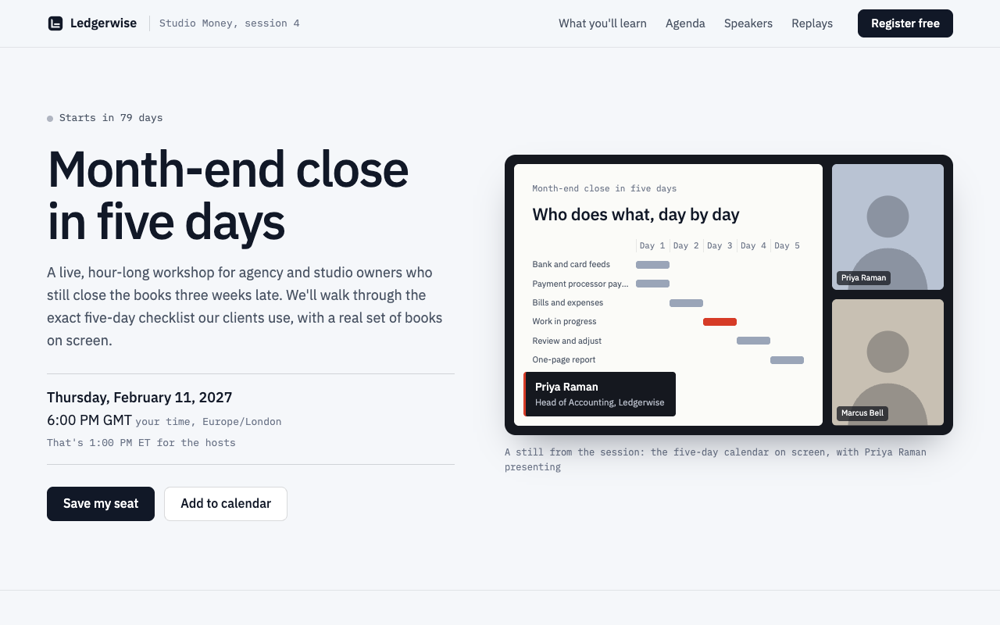

# Webinar landing page template

A landing page for a webinar or virtual event: the date in each visitor's own time zone, what they'll learn, a running order, speakers, a registration form, a calendar invite and a replay section. Built with Astro as a fully static site.



[](https://console.cloudzyro.com/new?repo=https://github.com/Cloudzyro/template-webinar)

## What's included

- Hero with the title, a still of the broadcast built in code (the slide, speaker tiles and a lower third) and the date and time converted to the visitor's time zone, with the host's time alongside
- A status line that counts down the days, says "Live now" during the session and "This session has ended" afterwards (the main button then says "Get the replay")
- "What you'll learn", a running order with timecodes and lengths, and speakers with bios
- Registration form (name, email, company, role, a question) that posts to any form service, with an email fallback and a confirmation with calendar links
- Calendar invite generated at build time (`/webinar.ics`) and an "Add to Google Calendar" link
- Replay section: paste an embed URL and a player appears that loads only when clicked; earlier sessions listed below
- FAQ, SEO (titles, descriptions, Open Graph and Twitter cards, `sitemap-index.xml`, `robots.txt`, favicon)
- Responsive down to 360px, keyboard friendly, visible focus styles, respects reduced motion
- No tracking and no third-party scripts; fonts are self-hosted

## Run it locally

```bash
pnpm install
pnpm dev       # http://localhost:4321
pnpm build     # static site in dist/
pnpm preview   # serve the build
```

Requires Node 22.23 or newer (`.nvmrc` pins 24).

## Make it yours

**Content.** Everything lives in [`src/data/webinar.ts`](./src/data/webinar.ts): host, title, subtitle, start time, length, platform, learning points, running order, speakers, form text and roles, past replays and FAQ.

**Time.** Set `startsAt` in UTC (for example `2027-02-11T18:00:00Z`) and `durationMinutes`. `hostTimeZone` and `hostTimeZoneLabel` set how the time reads before the visitor's browser converts it to their own zone. The calendar invite and the live and ended states all follow from these.

**Registration form.** Set a public environment variable to the address your form service gives you:

```bash
PUBLIC_FORM_ENDPOINT=https://formspree.io/f/your-form-id
```

It works with Formspree, Basin, a Supabase function or anything that accepts a form POST (you can also point it at your webinar tool's registration webhook through a service like that). Without it, the form says it isn't connected yet and opens the visitor's email app addressed to `contactEmail` with their details filled in. Copy `.env.example` to `.env` for local development; on Cloudzyro, add the variable in your site's settings and redeploy.

**Replay.** When the recording is ready, set `replayUrl` to an embed address such as `https://www.youtube-nocookie.com/embed/VIDEO_ID` and redeploy. The player only loads when someone presses play.

**Site address.** Set `SITE_URL` (or edit the fallback in `astro.config.mjs`) so the sitemap, `robots.txt`, the calendar invite and social previews use your domain.

**Colors and fonts.** Tokens are at the top of [`src/styles/global.css`](./src/styles/global.css): ink neutrals, `--live` for the on-air red and `--studio` for the broadcast frame. Fonts are IBM Plex Sans and IBM Plex Mono from Fontsource; change the imports in `src/layouts/Base.astro`.

**Images.** Speaker portraits are abstract placeholders from `src/components/Portrait.astro`; swap in real photos from `public/` with alt text. Replace `public/og.png` (1200x630) with your own social preview.

## Deploy

Click **Deploy to Cloudzyro** above, or push your own copy to GitHub and connect the repository in the Cloudzyro console. The build command is `pnpm build` and the output is the static `dist/` folder, so no server is needed.

## Stack

- [Astro](https://astro.build) 7, static output
- Hand-written CSS with custom properties
- [Fontsource](https://fontsource.org) self-hosted fonts
- `@astrojs/sitemap`

## License

MIT, see [LICENSE](./LICENSE).
